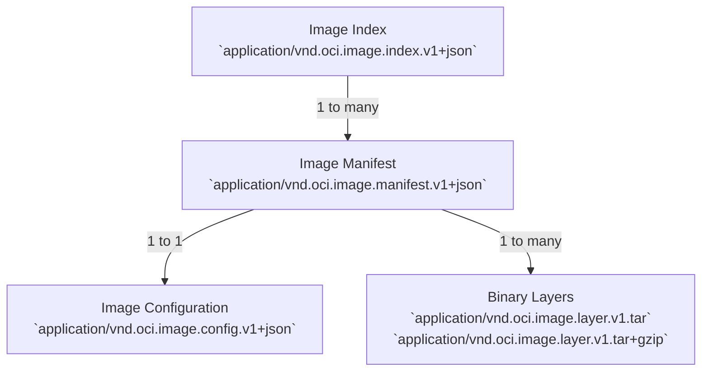

# Docker and OCI
In this tutorial we will be looking at the structure of an OCI registry and how it stores information.

# Deploy a local OCI Registry
## Pre-Requisites
You will need Docker-Desktop and the Docker CLI installed

## Deployment Steps
The following command will start an instance of the [Zot OCI Registry](https://zotregistry.dev/) in Docker Desktop
```bash
docker compose up
```
The Registry UI is accessible through a web browser at http://localhost:5000 


# The OCI Standard 1.0

The Open Container Initiative (OCI) is a Linux Foundation project, started in June 2015 by Docker, CoreOS, and the maintainers of `appc` (short for "App Container") to design open standards for operating system-level virtualization (containers). There are currently three OCI specifications in development and use: 
- *Runtime*: how to configure and execute a container.
- *Image*: how to package configuration, filesystem layers, and manifests.
- *Distribution*: how to transfer images and other content through registries, based on Docker’s Registry HTTP API V2.

The OCI Image Format Project was split out from the Runtime Project into its own specification on March 23, 2016 and was ratified into version 1.0.0 on July 19, 2017.

The first release defined the structure of a container. At it's base level, a container is a collection of binary object which can be retrieved by their digest (sha256 hash of the object). To make it easier for an application to decode those binary objects, the OCI standard defines a number of `mediaTypes`.

- `application/vnd.oci.image.index.v1+json` — image index
- `application/vnd.oci.image.manifest.v1+json` — image manifest
- `application/vnd.oci.image.config.v1+json` — image configuration
- `application/vnd.oci.image.layer.v1.tar` — uncompressed layer
- `application/vnd.oci.image.layer.v1.tar+gzip` — gzip-compressed layer

The different `mediaTypes` are arranged in a Hierarchical Graph shown below


## Content Descriptors
References between components in the graph are expressed through *Content Descriptors*. A Content Descriptor includes the `mediaType` of the (digest) which is used to identify and retrieve the content, and the byte-size of the raw stored data. Below is an example of a *Content Descriptors*
```json
{
  "mediaType": "application/vnd.oci.image.layer.v1.tar+gzip",
  "size": 7682,
  "digest": "sha256:5b0bcabd1ed22e9fb1310cf6c2dec7cdef19f0ad69efa1f392e94a4333501270",
  "annotatons": {    
    "com.example.layer-purpose": "application-layer",
    "com.example.compressed-algorithm": "gzip",
    "com.example.includes": "node_modules,bin"
  }
}
```
The `descriptor` contains everything an application need to know when interacting with content. It know how many bytes to download, how to request it via the `digest` and the storage format of the data. The described content might not be a single file, but be one-part in a mutli-part download that has to complete before the final object is constructed

Whilst `mediaType`, `size` and `digest` are mandatory, `annotations` are optional. They can be useful to provide an application more context about what they are accessing. You are free to use any key anem you wish, but the OCI standard has defined some predefine keys:

- `org.opencontainers.image.created` date and time on which the image was built (string, date-time as defined by RFC 3339).
- `org.opencontainers.image.authors` contact details of the people or organization responsible for the image (freeform string)
- `org.opencontainers.image.url` URL to find more information on the image (string)
- `org.opencontainers.image.documentation` URL to get documentation on the image (string)
- `org.opencontainers.image.source` URL to get source code for building the image (string)
- `org.opencontainers.image.version` version of the packaged software
- `org.opencontainers.image.revision` Source control revision identifier for the packaged software.
- `org.opencontainers.image.vendor` Name of the distributing entity, organization or individual.
- `org.opencontainers.image.licenses` License(s) under which contained software is distributed as an SPDX License Expression.
- `org.opencontainers.image.ref.name` Name of the reference for a target (string).


## Image Manifests
The *Image Manifest* (`application/vnd.oci.image.manifest.v1+json`) pulls multiple Content Descriptors together to describe an and OCI `Image`. Here is an example
```json
{
  "schemaVersion": 2,
  "mediaType": "application/vnd.oci.image.manifest.v1+json",
  "config": {
    "mediaType": "application/vnd.oci.image.config.v1+json",
    "size": 7023,
    "digest": "sha256:b5b2b2c507a0944348e0303114d8d93aaaa081732b86451d9bce1f432a537bc7"
  },
  "layers": [
    {
      "mediaType": "application/vnd.oci.image.layer.v1.tar+gzip",
      "size": 32654,
      "digest": "sha256:e692418e4cbaf90ca69d05a66403747baa33ee08806650b51fab815ad7fc331f"
    },
    {
      "mediaType": "application/vnd.oci.image.layer.v1.tar+gzip",
      "size": 16724,
      "digest": "sha256:3c3a4604a545cdc127456d94e421cd355bca5b528f4a9c1905b15da2eb4a4c6b"
    },
    {
      "mediaType": "application/vnd.oci.image.layer.v1.tar+gzip",
      "size": 73109,
      "digest": "sha256:ec4b8955958665577945c89419d1af06b5f7636b4ac3da7f12184802ad867736"
    }
  ],
  "annotations": {
    "com.example.key1": "value1",
    "com.example.key2": "value2"
  }
}
```
An OCI Image is composed of `layers`. Each layer represents a set of filesystem changes in a tar-based layer format, recording files to be added, changed, or deleted relative to the intial parent layer. Layers MUST be downloaded in order because each is an incremental change to the previous layer. For example the first layer maybe a base operating system image, with subsequent layers copying more files to build the complete image.

In the OCI manifest specification `config` is mandatory and is a content descriptor for a json document. In relation to OCI Container Images, this document it used to tell a container runtime how to deploy the images. However the specification did not state that the `mediaType` of the config had to be `application/vnd.oci.image.config.v1+json` nor that is had to have a content that complies with the standard. Any deviation would make this image useless to a container runtime but flexibility in definition did open up the OCI specification to be used for storing other things.

When the Helm community released Helm 3.8.0, they added support for pushing charts into an OCI Image registry by reusing the Image Manifest definition. And example of an Image Manifest for a helm chart is below:
```json
{
  "schemaVersion": 2,
  "config": {
    "mediaType": "application/vnd.cncf.helm.config.v1+json",
    "digest": "sha256:29ceb39d2de5f21ed34132328e61dbfe42f0ee18c64c9662d8d6d2446c27b661",
    "size": 157
  },
  "layers": [
    {
      "mediaType": "application/vnd.cncf.helm.chart.content.v1.tar+gzip",
      "digest": "sha256:5e17506d098c893015e65720881c8e15eaa2af85536840b74b6464da73f4a164",
      "size": 371
    }
  ],
  "annotations": {
    "org.opencontainers.image.created": "2026-11-16T19:29:45Z",
    "org.opencontainers.image.description": "A Helm chart to deploy a hello-world pod",
    "org.opencontainers.image.title": "hello-world",
    "org.opencontainers.image.version": "1.0.0"
  }
}
```

A user can use the Helm cli to pull the chart from the registry using `helm pull oci://example.com/example-chart:1.0.0` in a similar way to `docker pull`. If you look closely at the manifest above, it differentiates itself from being a definition of a Container Image by using `mediaTypes` values defined by the Helm community. The helm cli will first check the `mediaTypes` in the manifest to confirm this is a valid manifest before downloading any content. 

The same goes for other communities that have also appropriated the OCI standard. They also defined their own `mediaTypes` to cover their use cases.

# Image Manifest Index

The final type defined by the OCI spec is the Image Manifest List `application/vnd.oci.image.index.v1+json`. Below is an example of what one may look like:
```json
{
  "schemaVersion": 2,
  "mediaType": "application/vnd.oci.image.index.v1+json",
  "manifests": [
    {
      "mediaType": "application/vnd.oci.image.manifest.v1+json",
      "size": 7143,
      "digest": "sha256:e692418e4cbaf90ca69d05a66403747baa33ee08806650b51fab815ad7fc331f",
      "platform": {
        "architecture": "ppc64le",
        "os": "linux"
      }
    },
    {
      "mediaType": "application/vnd.oci.image.manifest.v1+json",
      "size": 7682,
      "digest": "sha256:5b0bcabd1ed22e9fb1310cf6c2dec7cdef19f0ad69efa1f392e94a4333501270",
      "platform": {
        "architecture": "amd64",
        "os": "linux"
      }
    }
  ],
  "annotations": {
    "com.example.key1": "value1",
    "com.example.key2": "value2"
  }
}
```

This is similar to a manifest except that is is a list of content descriptor for manifests not layers/blobs. These become useful when your application want to pull multiple artifacts or a specific artifacts based on a filter. The OCI Image spec has hard coded the use of `platform` as on of the items a user can filter on.

The `platfrom` attribute allows your users to pull the manifest list using `docker pull` and have returned the manifest that relates to their current OS/Processor configuration. The command `docker pull` has an argument `--platform` which can be used to point docker to the correct manifest if the cli is unable to do set the platform for you. Values may be `linux\arm64`, `windows\386` etc.

## OCI 1.1 and ORAS
As mentioned earlier, many communities started trying to use OCI registries to store there resources along side the OCI Images they build/deploy. Builders wanted to digitally sign their Images and provide and digital Software Bill of Materials (SBOM) so the consumer to have a greater trust in the images the consumed. In an effort to formalise these practices, the ORAS community was formed. ORAS stands for OCI Registry As Storage and their community has worked with the OCI standards body on the writing of OCI standard 1.1 to better support none Container Image use cases. The ORAS website has a list of OCI registries and application that have support for OCI 1.1 and are able to understand manifest that diverge from the container image specification [link](https://oras.land/adopters). They have also produced a CLI tool which will will make much use of in the rest of this tutorial [link](https://oras.land/docs/category/oras-commands).

The important changes that came with OCI 1.1 are

### artifactType
Even though `mediaType` had no hard definition, tools expected its values mean something specific. To remove the ambiguity around `mediaType` usage, OCI 1.1 added an optional `artifactType` parameter to the Content Descriptor definition. Any example of `artifactType` in action is below:
```json
{
  "schemaVersion": 2,
  "mediaType": "application/vnd.oci.image.manifest.v1+json",
  "artifactType": "application/sbom+json",  // ← Clear: this IS an SBOM
  "config": {
    "mediaType": "application/vnd.oci.empty.v1+json",  // ← Can be empty; no semantic meaning
    "digest": "sha256:44136fa355b3678a1146ad16f7e8649e94fb4fc21fe77e8310c060f61caaff8a",
    "size": 2
  },
  "layers": [ ... ]
}
```
The `mediaType` tells a tool to process this document as a standard OCI Manifest but the `artifactType` can inform the user what this artifact is. In this case it's and SBOM in JSON format.

The OCI standard also standardised how an empty object is defined using the mediaType `application/vnd.oci.empty.v1+json`. This is to support backwards compatibility as having and empty field or removed it completely may effect older repositories.

### subject
As mentioned earlier, one of the main drivers for improving the support of other artifactTypes in OCI was the need to store artifacts associated with Image. These most important are SBOM and Code signatures. When a user transfers an image from a global OCI regostry to their local OCI registry, they would also want to pull any associated artifacts which would go with it. 

The `subject` parameter was added to allow an associated artifact to state what resource it relates to. A more complete example of an SBOM manifest is below. It contains a `subject` which contains a Content Descriptor for an Image Manifest.
```json
{
  "schemaVersion": 2,
  "mediaType": "application/vnd.oci.image.manifest.v1+json",
  "artifactType": "application/sbom+json",  // ← NOW IT'S CLEAR: this is an SBOM
  "subject": {
    "mediaType": "application/vnd.oci.image.manifest.v1+json",
    "digest": "sha256:5b0bcabd1ed22e9fb1310cf6c2dec7cdef19f0ad69efa1f392e94a4333501270"  // ← Points to the image it belongs to
  },
  "config": {
    "mediaType": "application/vnd.oci.empty.v1+json",  // Empty, since this isn't a runnable image
    "digest": "sha256:44136fa355b3678a1146ad16f7e8649e94fb4fc21fe77e8310c060f61caaff8a",
    "size": 2
  },
  "layers": [
    {
      "mediaType": "application/json",
      "digest": "sha256:def456...",
      "size": 10000
    }
  ]
}
```
The OCI registry API definition in the OCI Distribution spec was updated to have a `referrers` resource. To find all SBOM artifacts related to an image we would call:
```http
GET /v2/<name>/referrers/<digest>?artifactType=application/sbom+json
```

